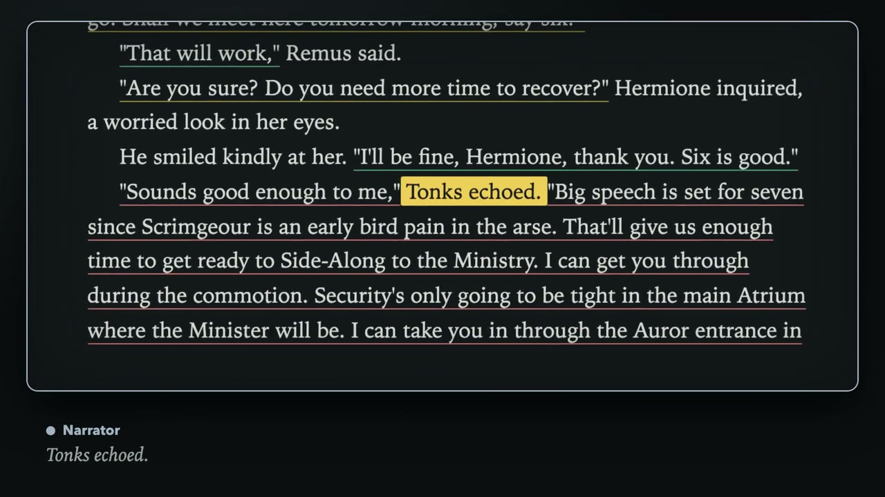
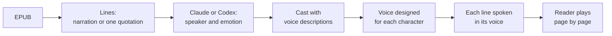

# me-read

Read any EPUB as a radio play. me-read gives the narrator and every character their own voice, then reads the book to you while you follow the text.

https://github.com/user-attachments/assets/2e310850-259e-4e7d-a317-d64d13834d19

*45 seconds, with sound. The video shows a real book, real voices, and changing a voice you don't like.*

Drop in a book and press play. Claude or Codex works out who says each line and how they say it. A voice model on your Mac designs a voice for each character from a short description, then speaks every line in that voice. The voice work runs locally, and the Claude or Codex calls use the login you already have, so there is no extra bill.



## What it does

- **A cast for every book.** The tagger finds each speaker, including unnamed ones such as "Guard 1", and describes how they sound. You can rename characters, merge two that are the same person, or add someone the tagger missed.
- **A voice for every character.** Each character gets a 15-second voice designed from their description. If you don't like one, try another and listen before you keep it, or upload your own recording. Their lines are then read again in the new voice.
- **Lines read with feeling.** In English books, a line can be happy, sad, angry, scared, whispered, or yelled. me-read makes a take of the character's voice in each emotion and reads the line from it.
- **No waiting at page turns.** Audio is prepared for the page before, the page you are on, and the page after.
- **Your place is kept.** Opening a book again continues at the exact line where you stopped.
- **Media keys work.** Play, pause, next line, and previous line work from the keyboard, Control Center, and Bluetooth headsets.
- **Pictures, if you have a GPU.** With an optional image service, the reader draws key moments as you reach them and keeps each character's look consistent.

## Quick start

You need:

- A Mac with Apple Silicon. Speech runs on it with [MLX](https://github.com/ml-explore/mlx).
- [uv](https://docs.astral.sh/uv/), Node.js, and pnpm. Install them with `brew install uv node pnpm`.
- The [Claude Code](https://docs.anthropic.com/en/docs/claude-code) CLI (`claude`) or the [Codex](https://github.com/openai/codex) CLI (`codex`), installed and logged in.

Clone the repository and start it:

```sh
git clone https://github.com/nemesiscodex/me-read.git
cd me-read
./start
```

`./start` builds the web app and starts the reader. When you see `Starting the reader at http://127.0.0.1:8765`, open that address and drop an EPUB on the library. Press Ctrl-C in the terminal to stop.

The first book downloads its voice models, about 5.8 GB for an English book and about 4 GB more for a Spanish one. Lines start playing once their characters have voices. After that, only new characters and new pages need work.

Your books, voices, and audio are kept in `~/.local/share/me-read`. To keep them somewhere else, set `ME_READ_HOME` or pass `--home`. Run `./start --help` to see every option.

To find a book to try, [Project Gutenberg](https://www.gutenberg.org/) has free EPUBs, for example *The Adventures of Sherlock Holmes*. Books with a lot of dialogue show off the cast best.

## Use the reader

- **Change who says a line, or how.** Right-click the line.
- **Hear and change voices.** Open the Cast panel. Each voice shows its emotion takes, which you can play or make again.
- **Choose Claude or Codex, and the model.** Open the library's settings.
- **Pause the tagger.** Click **Claude on** (or **Codex on**) in the reader. It also shows how many calls it made today. While it is paused, the narrator reads lines that have no speaker yet.
- **Turn pictures on or off.** Click **Pictures on**. The switch appears once an image service is set.

## Choose a narrator

Chatterbox is the default narrator. It reads English and Spanish. Fish (English and Spanish) and Breeze (English only) are also available:

```sh
./start --tts-provider fish
```

[Narrators and voice models](docs/narrators.md) compares the three and lists every model me-read downloads.

## Use a GPU machine

Voice design and narration run on the Mac by default. If you also have a Linux machine with a GPU, it can do the heavy speech work or draw the pictures. Install me-read's speech service, image service, or both on it once. After that, one flag tells `./start` to use the machine, and later starts remember it:

```sh
./start --gpu-host my-gpu-box
```

[Run speech and pictures on a GPU machine](docs/gpu-machine.md) walks through it.

## What leaves your Mac

- **Book text goes to Claude or Codex.** The tagger sends the paragraphs around your page, the cast so far, and a little earlier text through your `claude` or `codex` CLI. Pictures, when they are on, send the same kind of text in a second call.
- **Nothing else does by default.** Voice design, narration, and transcription run on your Mac.
- **A GPU machine gets more.** If you use one, the text and the voices travel to it over an SSH tunnel.

## Limits

- Books in English and Spanish. me-read detects the language at import. Dialogue can be in quotation marks (“…”, "…", «…», British ‘…’) or introduced by dashes (—Hola —dijo Ana—. ¿Vienes?).
- Emotion takes are made for English books only. Other books read every line in the character's own voice.
- Formatting inside paragraphs, such as italics, links, and images, is dropped.
- One reader at a time. The server prepares the pages of whichever book reported its position last.
- Machine voices make mistakes. A character may sound wrong, and the tagger sometimes picks the wrong speaker. Both are quick to correct.

## Licences

me-read's code is under the [MIT licence](LICENSE). The models it downloads have their own licences:

| Model | Used for | Licence |
|---|---|---|
| Chatterbox and Chatterbox Turbo | narration (default) | MIT |
| Breeze TTS 2 | designing English voices, emotion takes, optional narrator | [BreezeBlue Research and Non-Commercial](https://huggingface.co/mlx-community/Breeze-TTS-2-mlx-4bit) |
| Qwen3-TTS VoiceDesign | designing voices for other languages | Apache 2.0 |
| Whisper large v3 turbo | transcribing voices for emotion takes | MIT |
| Fish Audio S2 Pro | optional narrator | [Fish Audio Research](https://huggingface.co/mlx-community/fish-audio-s2-pro-8bit) |
| FLUX.2 klein 4B | pictures, on the image service | Apache 2.0 |

Breeze designs the English voices in the default setup, so treat what me-read makes as non-commercial. Review each publisher's terms before you use the audio for anything else.

## How it works



Only the pages around you are processed, starting with the page you are on. Four background workers each ask the database for the next most useful job: tagging, finding moments to draw, speech, and pictures. Corrections and restarts need no queue bookkeeping, because the next job is always worked out from what is already done. [How me-read works](docs/how-it-works.md) explains each step.

## Development

| Folder | What it is |
|---|---|
| `server/` | The Python server: EPUB import, tagging, voices, speech, and the HTTP API (FastAPI). `./start` runs `server/meread/launch.py`. |
| `web/` | The reader and library (React and Vite). |
| `speech-service/` | Optional. The speech service for a Linux GPU machine. |
| `imager/` | Optional. The image service for a Linux GPU machine. |

Run the tests:

```sh
cd server && uv run pytest
cd web && pnpm test
```

For frontend work, keep the server running and start Vite in `web/`. It serves on port 5183 and forwards `/api` to the server:

```sh
cd web && pnpm dev
```
